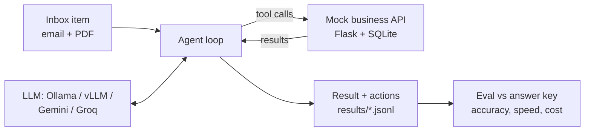

# AI Inbox & Invoice Triage Agent

An AI agent that does the repetitive inbox work at a small online store: it reads customer emails and supplier invoice PDFs, decides what each one is, checks the business database, and takes the right action through a REST API, such as opening a support ticket, recording an invoice for payment, flagging a problem for a human, or marking spam.

It runs on **local models** (Ollama, vLLM) or **hosted LLM APIs** (Gemini, Groq) with one setting, and comes with an **evaluation harness** that scores every run on accuracy, speed and cost against a labeled answer key.

> All data is fictional. "Cedar Lane Home Goods", its customers and suppliers are made up, and every email address uses the reserved `.example` domain.

## Results

| Run | Model | Category | Action | Fields | Fully correct | Avg sec/item | Cost per 100 items |
|---|---|---:|---:|---:|---:|---:|---:|
| Keyword rules (baseline) | none | 81.9% | 75.2% | 77.8% | **71.4%** | 0.01 | $0 |
| _your Ollama run_ | | | | | | | |
| _your vLLM run_ | | | | | | | |
| _your hosted API run_ | | | | | | | |

105 inbox items. "Fully correct" means the category, the action and every extracted field were all right. Fill in the empty rows with your own runs (`python -m evals.evaluate results/*.jsonl` prints this table).

## How it works



1. **Inbox** (`data/`): 105 messages: refund requests, shipping complaints, billing questions, supplier invoices with PDF attachments, and spam. Some are deliberately hard: no obvious keywords, unusual order number formats ("ORD 10023", "#10023"), suppliers who print PO numbers differently, a customer who writes "I don't want a refund", lookalike phishing domains, and a customer writing from an email address that isn't on file.
2. **Agent** (`agent/`): sends each message to the model with a policy and 8 tools. The model looks things up, takes exactly one action, then reports the category and extracted fields. The loop is written by hand (about 50 lines in `agent/agent.py`) to show what agent frameworks do under the hood.
3. **Business API** (`api/`): a Flask REST API over SQLite that stands in for the company's real systems. It also enforces rules: it refuses to record an invoice whose total doesn't match the purchase order.
4. **Eval** (`evals/`): compares every result with the answer key and reports accuracy per category, the exact failures, average time per item, token use and cost.
5. **Baseline** (`agent/baseline.py`): plain keyword rules with no AI, so there is a number the LLM has to beat.

### The business policy the agent follows

| Message | Action |
|---|---|
| Spam, scam or phishing | `mark_spam` |
| Supplier invoice, PO exists and total matches | `record_invoice` |
| Supplier invoice, unknown PO or wrong total | `flag_for_human` |
| Refund or shipping issue with a valid order that belongs to the sender | `create_ticket` (refund / shipping) |
| Refund or shipping issue with no order number, an unknown order, or someone else's order | `flag_for_human` |
| Billing question | `create_ticket` (billing) |

## Setup

You need **Python 3.10 or newer** (tested on 3.11 to 3.13). Commands below are run from the project folder.

```bash
python -m venv .venv
# Windows:      .venv\Scripts\activate
# macOS/Linux:  source .venv/bin/activate
pip install -r requirements.txt
```

## Run it

**1. Generate the data** (already included in the repo; this rebuilds it identically):

```bash
python -m data.generate_data
```

**2. Start the business API** in its own terminal (activate the virtual environment there too), and leave it running:

```bash
python -m api.app
```

**3. Run the baseline and score it** (in your first terminal):

```bash
python -m agent.run --provider baseline
python -m evals.evaluate results/baseline.jsonl
```

**4. Run a local model with Ollama.** Install Ollama from [ollama.com](https://ollama.com), then:

```bash
ollama pull qwen2.5:7b
python -m agent.run --provider ollama --model qwen2.5:7b --limit 5    # quick test first
python -m agent.run --provider ollama --model qwen2.5:7b              # all 105 items
python -m evals.evaluate results/*.jsonl                              # compare every run
```

On a laptop without a GPU each item can take 10 to 60 seconds, so the full run may take an hour or more. `qwen2.5:3b` is faster but less accurate, which is itself a useful comparison. If results look like the model is ignoring its instructions, raise Ollama's context length (Ollama app settings, or `OLLAMA_CONTEXT_LENGTH=8192 ollama serve`).

**5. Run vLLM on a free GPU:** see [docs/vllm_colab.md](docs/vllm_colab.md).

**6. Run a hosted API (optional).** Copy `.env.example` to `.env`, then set `LLM_API_KEY` and `LLM_MODEL` (copy a current model name from the provider's docs). Free tiers have rate limits; the client waits and retries automatically.

```bash
python -m agent.run --provider gemini
python -m agent.run --provider groq
```

Any other OpenAI-compatible server works with `--provider custom --base-url <url> --model <name>`.

### Useful options

```bash
python -m agent.run --provider ollama --name ollama-prompt-v2    # name a run (results/<name>.jsonl)
python -m agent.run --provider ollama --resume                   # continue a stopped run
python -m agent.run --provider ollama --ids item-003,item-024 --name debug   # try specific items
python -m evals.evaluate results/ollama-prompt-v2.jsonl --all-failures
```

Results are saved after every item, so stopping with Ctrl+C keeps what's finished, and `--resume` picks up where it left off (redoing any items that ended in an error). Without `--resume`, reusing a run name starts that run over. Each results line includes the full list of tool calls, which is the first place to look when an item fails.

## Improving the score

The prompt lives in `agent/prompts.py`. A good workflow:

1. Run the eval and read the failures list. Each one shows what was expected, what the agent did, and what kind of case it was.
2. Change one thing in the prompt (a clearer rule, an example, a warning about a trap).
3. Rerun with a new `--name` and compare. Keep the version that wins, and write down what changed and how the score moved in "What I learned" below.

## What I learned

_Fill this in from your own runs. Examples of things worth writing about: which categories the local model struggled with, how much a prompt change moved the score, how a small local model compared with a hosted one on accuracy, speed and cost, and which failures surprised you._

## Project structure

```
data/generate_data.py   builds the database, inbox, invoice PDFs and answer key (fixed random seed)
data/items.jsonl        the inbox (what the agent sees)
data/labels.jsonl       the answer key (what the eval checks against)
data/invoices/          supplier invoice PDFs
api/app.py              mock business REST API (Flask + SQLite)
agent/agent.py          the agent loop
agent/tools.py          tool definitions and the code that runs them
agent/prompts.py        the system prompt
agent/llm.py            client for any OpenAI-compatible chat API
agent/config.py         model switcher (providers, models, costs)
agent/baseline.py       keyword-rules baseline
agent/run.py            command-line runner
evals/evaluate.py       scoring and the comparison report
shared/normalize.py     cleans up IDs and amounts so formats compare equal
tests/                  49 tests, including an end-to-end run with a fake "perfect" model
```

## Tests

```bash
python -m unittest
```

The tests don't need a real model or internet. They cover the API, the agent loop (with a fake model server, including bad tool arguments, rate limits and server errors), the eval, and the data itself: every label is re-checked against the database and the PDF text. One end-to-end test runs the real runner, API and eval with a fake model that always makes the right calls, and requires a score of exactly 100%.
